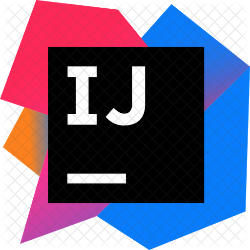
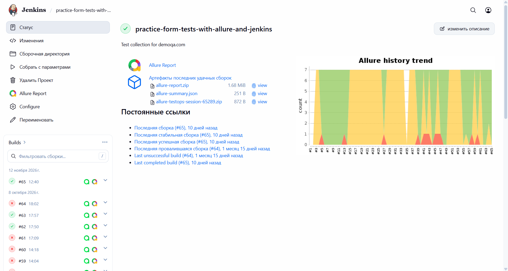
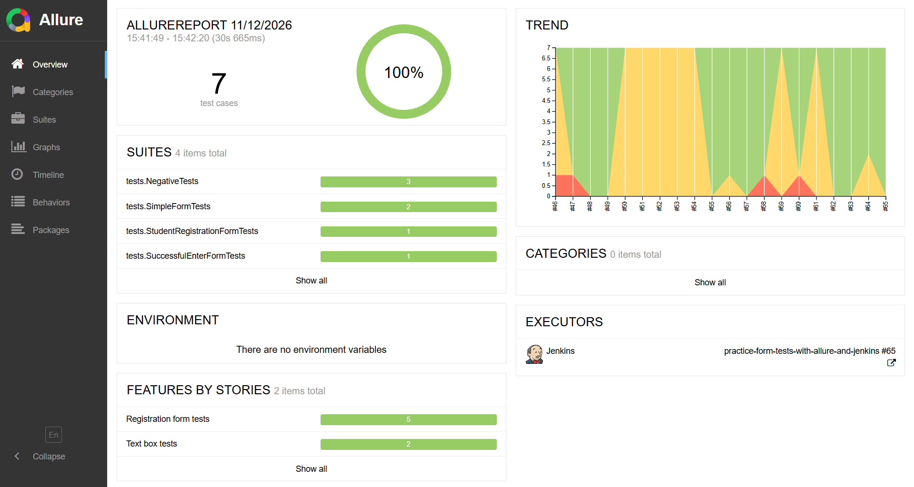
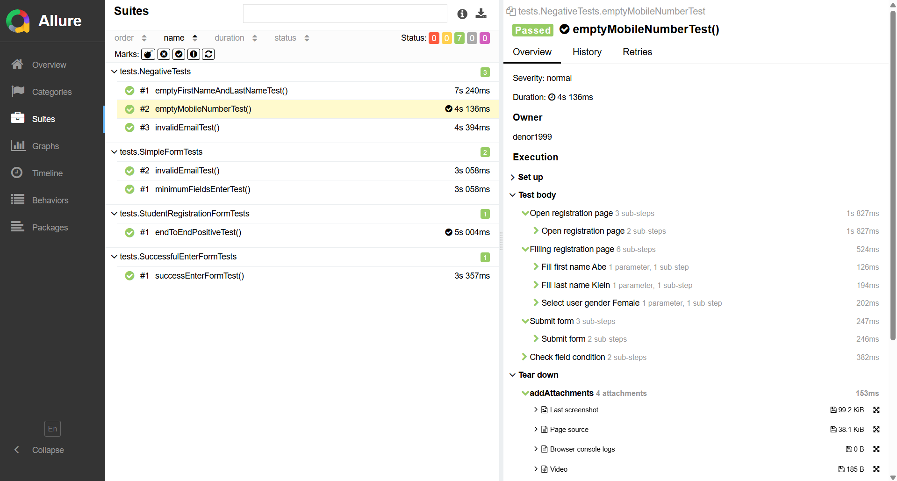
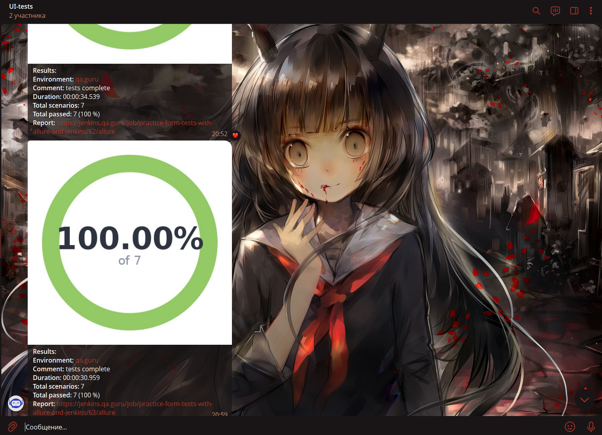
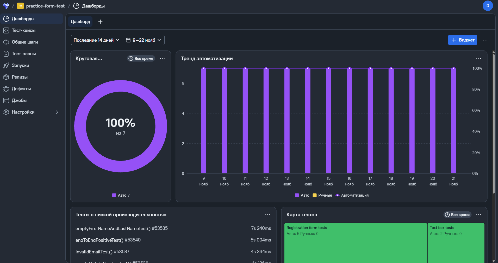
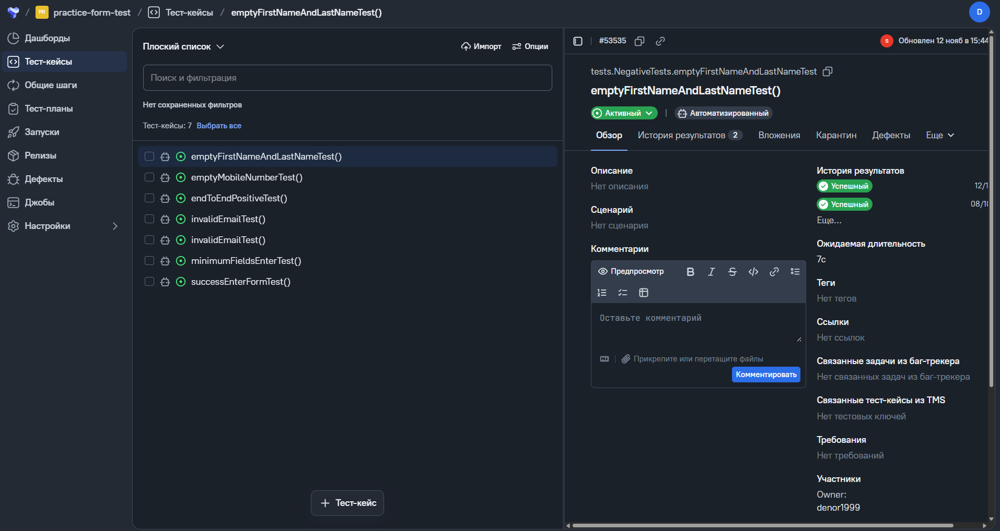

# Проект по автоматизации UI тестирования сервиса [demoqa.com](https://demoqa.com/)
<a href="https://demoqa.com/"></a>

---

## Структура:
- <a href="#-стек">Стек</a>
- <a href="#-тесты">Проведённые тесты</a>
- <a href="#-сборка">Сборка в Jenkins</a>
- <a href="#-запуск-из-терминала">Запуск из терминала</a>
- <a href="#-отчёт">Allure отчёт</a>
- <a href="-отчёт-в-телеграм">Отчёт в Telegram</a>
- <a href="#-интеграция-с-Allure-TestOps">Интеграция с Allure TestOps</a>

---

## 🛠️ Стек:
<p align="center">




</p>

---

## ✅ Проведённые тесты
- Заполнение регистрационной формы
    - Всех полей
    - Обязательных полей
    - Отправка пустой формы
- Заполнение Text Box
    - С помощью случайных значений в полях вода
    - Параметризованные значения

---

## 📋 Сборка в [Jenkins](https://jenkins.qa.guru/job/practice-form-tests-with-allure-and-jenkins)
<p>

</p>

### Параметры сборки в Jenkins:
Сборка в Jenkins

- Remote_Url (среда запуска, по умолчанию выбран запуск на Selenoid)
- Browser (браузер, по умолчанию Chrome)
- Browser_Version (версия браузера, по умолчанию для Chrome 148.0)
- Browser_Size (размер окна браузера, по умолчанию 1920х1080)
- Headless (невидимый запуск, по умолчанию false)
- Base_Url (по умолчанию https://demoqa.com)
- Text_Box_Path (эндпоинт для text box формы, по умолчанию /text-box)
- Registration_Form_Path (эндпоинт для регистрационной формы, по умолчанию /automation-practice-form)

---

## ▶️ Запуск из терминала
Локальный запуск:
```shell
gradle clean test -Dremote='%your_remote%' -Dbrowser=chrome -Dbrowser_version=148 -Dsize=1920x1080 -Dbase_url=https://demoqa.com -Dform_path=/automation-practice-form -Dtext_box_path=/text-box
```
Удаленный запуск:
```shell
clean test
browser=$Browser
browser_version=$Browser_Version
remote_url=$Remote_Url
size=$Browser_Size
base_url=$Base_Url
form_path=$Registration_Form_Path
text_box_path=$Text_Box_Path
headless=$Headless
```

---

## Allure отчёт

- ### Главынй экран
<p>

</p>

- ### Страница с тестами
<p>

</p>

---

## 💬 Отчёт в Telegram
<p>

</p>

---

## 📑 Интеграция с Allure TestOps

- ### Результаты запуска тестов
<p>

</p>

- ### Проведённые тесты
<p>

</p>

---

## 🎦 Примеры запусков тестов
> К каждому тесту в отчете прилагается видео.
<p>
    
    
</p>
